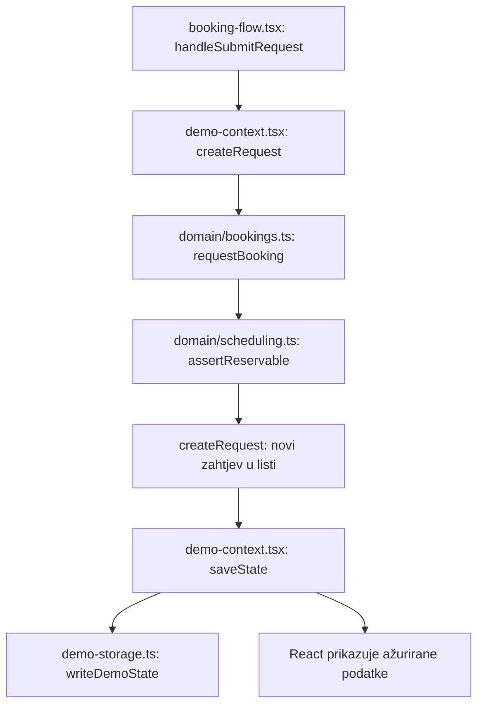

# Kako čitati i održavati Terapeut.me

Ovaj vodič je za osobu koja zna osnove JavaScripta, ali tek upoznaje Next.js, NestJS i TypeScript. Za poslovni dogovor prvo pročitajte [decisions.md](decisions.md). Ovaj fajl objašnjava gdje se taj dogovor nalazi u kodu.

## Tri dijela projekta

| Folder            | Šta radi                                            | Gdje početi                                                    |
| ----------------- | --------------------------------------------------- | -------------------------------------------------------------- |
| `apps/web`        | Stranice koje korisnik vidi, formulari, kalendari   | `src/app/layout.tsx`                                           |
| `packages/domain` | Pravila zakazivanja, bez HTML-a i pristupa browseru | `src/scheduling.ts`, zatim `src/bookings.ts`                   |
| `apps/api`        | Budući serverski dio; trenutno samo provjera rada   | `src/main.ts`, `src/app.module.ts`, `src/health.controller.ts` |

`workspaces` u glavnom `package.json` povezuje ova tri dijela. Jedno `npm.cmd install` instalira njihove zavisnosti. Import `@terapeut/domain` znači zajednički paket iz ovog projekta, a ne biblioteku preuzetu sa interneta.

**Frontend trenutno koristi demo podatke iz browsera.** Nije povezan sa NestJS API-jem ni PostgreSQL bazom. SQL model postoji i može se provjeriti zasebno, ali klik na dugme za rezervaciju još ne šalje podatke serveru.

## Kako Next.js pronađe stranicu

Next.js koristi nazive foldera unutar `apps/web/src/app`. Fajl `page.tsx` predstavlja jednu stranicu. Fajl `layout.tsx` je omotač oko stranica: dodaje zajednički HTML i komponente.

| Adresa u browseru              | Ulazni fajl u `src/app`          | Glavni prikaz                  |
| ------------------------------ | -------------------------------- | ------------------------------ |
| `/`                            | `page.tsx`                       | Početna stranica u istom fajlu |
| `/psychotherapy`               | `psychotherapy/page.tsx`         | `features/directory.tsx`       |
| `/therapist/ana-markovic`      | `therapist/[id]/page.tsx`        | `features/profile.tsx`         |
| `/therapist/ana-markovic/book` | `therapist/[id]/book/page.tsx`   | `features/booking-flow.tsx`    |
| `/dashboard`                   | `dashboard/page.tsx`             | `features/dashboard.tsx`       |
| `/faq`, `/privacy`, `/terms`   | Odgovarajući folder i `page.tsx` | Sadržaj u samom fajlu          |

`[id]` znači promjenljivi dio adrese. Next.js iz njega daje `params`, a `ProfilePage` ili `BookingPage` čita ID i prosljeđuje ga prikazu. `await params` je dio načina na koji ova verzija Next.js daje parametre stranice; ovdje ne predstavlja poziv bazi.

`metadata` podešava naslov browser taba i opis stranice. `loading.tsx` prikazuje učitavanje, `error.tsx` grešku sa ponovnim pokušajem, a `not-found.tsx` nepostojeću adresu.

## Kako čitati React prikaz

Funkcija koja vraća HTML-sličan zapis, npr. `BookingFlow`, jeste komponenta. Taj zapis se zove JSX. U njemu `className` označava CSS klasu, a `{...}` prikazuje vrijednost iz JavaScripta. CSS se nalazi u `app/globals.css`, sa komentarima po cjelinama.

Komponenta dobija ulazne podatke kao argumente, često nazvane _props_. Na primjer, `<CalendarPicker duration={60} ... />` govori kalendaru koliko traje seansa. Povratna funkcija poput `onDate` govori roditeljskom prikazu koji je datum korisnik izabrao.

`"use client"` na početku fajla znači da komponenta koristi browser, događaje ili React stanje. Poslovna pravila u `packages/domain` to ne koriste i ne treba im taj red.

Najčešći oblici u ovom projektu:

```tsx
// useState pamti izbor. Poziv setSelectedStart ponovo prikazuje ekran.
const [selectedStart, setSelectedStart] = useState<number | null>(null);

// onClick samo povezuje dugme sa jasno imenovanom funkcijom.
<button onClick={submitProposal}>Pošalji predlog</button>;

// Poslovna pravila su u funkciji, a ne sakrivena unutar velikog HTML-a.
function submitProposal() {
  // Provjera i slanje predloga nalaze se u features/booking-card.tsx.
}
```

`useEffect` pokreće rad poslije prikaza u browseru. Koristimo ga za učitavanje podataka i timer. Ako postavlja timer ili sluša događaje, mora vratiti funkciju koja ih uklanja. U `demo-context.tsx` to je `stopListening`.

`useRef` čuva najnovije podatke za timer bez čekanja novog prikaza. `useCallback` tamo zadržava istu funkciju za čuvanje, da se učitavanje i timer ne pokreću ponovo poslije svake izmjene. Ovi alati nijesu potrebni za svaku funkciju ili formular.

TypeScript dodaje opis podataka JavaScriptu. `Booking` je oblik zahtjeva iz `types.ts`, `Booking | null` znači „zahtjev ili još nema vrijednosti“, a `Partial<Therapist>` znači da šaljemo samo izmijenjena polja profila. Tipovi pomažu editoru i provjeri, ali ne zamjenjuju provjeru korisnikovog unosa.

Kod koristi nekoliko običnih operacija nad listom:

| Zapis             | Značenje                                                            |
| ----------------- | ------------------------------------------------------------------- |
| `.find(...)`      | Pronađi jedan element, npr. zahtjev po ID-u                         |
| `.filter(...)`    | Napravi listu samo elemenata koji odgovaraju uslovu                 |
| `.map(...)`       | Napravi novu listu sa obrađenim elementima                          |
| `.some(...)`      | Provjeri da li postoji bar jedan element koji odgovara              |
| `...booking`      | Kopiraj postojeća polja; polja navedena poslije mogu da ih zamijene |
| `state?.bookings` | Čitaj listu samo ako state već postoji                              |

Za računanje slobodnih intervala koristimo obične `for` petlje, da svaki korak bude vidljiv.

## Gdje su podaci i akcije

`app/layout.tsx` omotava sve stranice komponentom `DemoProvider`. Ona predstavlja zajedničko mjesto za podatke. Poziv `useDemo()` daje pristup stanju i akcijama.

| Fajl                           | Odgovornost                                              |
| ------------------------------ | -------------------------------------------------------- |
| `lib/demo-context.tsx`         | Učitava stanje i povezuje akcije sa pravilima i čuvanjem |
| `lib/demo-storage.ts`          | Čita i piše JSON u `localStorage` browsera               |
| `lib/errors.ts`                | Pretvara oznake grešaka u poruke korisniku               |
| `lib/format.ts`                | Formatira datum i pretvara sate u minute                 |
| `lib/excel-export.ts`          | Pravi i preuzima Excel, bez slanja emaila                |
| `packages/domain/src/types.ts` | Opisuje polja profila, usluge, zahtjeva i istorije       |
| `packages/domain/src/seed.ts`  | Izmišljeni početni profili i demo zahtjevi               |

`translate("Tekst", "English text")` bira jedan od dva već napisana teksta. Ne prevodi automatski. Nazivi `nameEn`, `bioEn` i slični sadrže englesku verziju podatka.

`localStorage` čuva tekst samo u određenom browseru. `JSON.stringify` pretvara podatke u tekst, a `JSON.parse` ih vraća u objekat. Verzija skladišta je 1. Nemojte mijenjati oblik sačuvanih podataka bez plana za stare podatke ili reset demo verzije.

## Kako nastaju ponuđeni termini

Kalendar nije spisak unaprijed sačuvanih pojedinačnih termina. Računa moguće početke iz dostupnosti i već zauzetog vremena.

1. `BookingFlow.chooseService` pamti uslugu i traži prvi dostupan datum.
2. `CalendarPicker.getStartsForDate` poziva `availableStarts`.
3. `freeRanges` uzima sate dostupnosti za taj dan i oduzima zahtjeve i blokade.
4. `availableStarts` prolazi kroz slobodne intervale na 15 minuta i zadržava početke gdje cijela seansa staje.

Vrijeme u podacima je broj minuta od ponoći: **16:00 = 960**, **16:15 = 975**. `timeLabel` služi samo za prikaz. Datum je tekst `YYYY-MM-DD`. Zona projekta je `Europe/Podgorica`.

Primjer: dostupno 16–20, zauzeto 16–16:15, usluga 60 minuta. Prvi mogući termin je 16:15–17:15. Zahtjevi na čekanju takođe zauzimaju interval. Sve usluge jedne osobe koriste istu zauzetost.

## Šta se desi na „Pošalji zahtjev“



Formular čita ime, email i telefon. `requestBooking` provjerava kontakt, uslugu i termin. Cijenu i trajanje uzima iz usluge, a ne iz proizvoljnog formulara. Kopija tih vrijednosti ostaje u zahtjevu čak i ako terapeut kasnije izmijeni uslugu.

Ako provjera ne uspije, `DomainError` nosi oznaku poput `SLOT_UNAVAILABLE`. `errorText` daje poruku na ekranu. Ne zaobilaziti provjeru samo zato što je dugme ranije prikazalo slobodan termin.

## Promjena A → B

U `booking-card.tsx` funkcija `submitProposal` poziva demo akciju `propose`. Ona vodi u `proposeNewTime`, pa u `domain/bookings.ts: proposeAlternative`.

**B se prvo provjerava.** Ako nije dostupan, zahtjev ostaje na A. Ako jeste, jedna nova verzija zahtjeva dobija B i status `ALTERNATIVE_PROPOSED`. U istom čuvanju A prestaje da blokira kalendar, a B počinje da ga blokira. Prethodni datum i početak upisuju se u istoriju.

Ne praviti dvije odvojene radnje „oslobodi A“ i „zauzmi B“. U budućem API-ju zahtjev, događaj istorije i obavještenje moraju biti dio iste transakcije baze.

## Kako je podijeljen dashboard

`features/dashboard.tsx` bira demo ulogu i ekran. Konkretni sadržaj je odvojen:

| Fajl                     | Šta se tu mijenja                                  |
| ------------------------ | -------------------------------------------------- |
| `requests-list.tsx`      | Grupisanje po statusu i broj zahtjeva              |
| `booking-card.tsx`       | Detalji i dugmad za pojedinačni zahtjev            |
| `week-calendar.tsx`      | Nedjeljni raspored i položaj blokova po satima     |
| `therapist-settings.tsx` | Dodavanje usluga, dostupnosti i uređivanje profila |
| `service-editor.tsx`     | Formular uređivanja jedne usluge                   |
| `admin-dashboard.tsx`    | Verifikacija, javna aktivnost i dugme za izvoz     |

`?mode=admin` ili `?mode=therapist` u adresi služi za demo. **To nije autentifikacija.** Pravi API mora provjeravati ulogu i vlasništvo na serveru; skriveno dugme nije zaštita.

## Kako čitati NestJS dio

`main.ts` je ulaz u API. `bootstrap` kreira aplikaciju iz `AppModule`, dodaje početak adrese `/api/v1`, podešava dozvoljeni frontend i otvara port 4000.

`app.module.ts` je spisak dijelova koje NestJS treba da uključi. Trenutno uključuje samo `HealthController`. `health.controller.ts` povezuje adresu sa funkcijom:

```text
main.ts: /api/v1 + @Controller("health") + @Get() = GET /api/v1/health
```

Zapisi koji počinju sa `@` nazivaju se dekoratori. Oni NestJS-u govore na kojoj adresi treba pozvati metodu. `health()` vraća objekat koji server šalje kao JSON. Trenutno pošteno navodi da booking API i baza nijesu povezani.

`.env.example` je primjer vrijednosti. Samo kopiranje tog fajla trenutno ne učitava varijable u NestJS: `main.ts` čita `process.env` iz procesa koji ga pokreće. Učitavanje `.env` konfiguracije dolazi pri povezivanju backend servisa.

## Baza i konfiguracija

`compose.yaml` pokreće lokalni PostgreSQL na portu 5432. `db/schema.sql` pravi tabele samo kada Docker kreira **novu** bazu. Izmjena SQL fajla ne mijenja već postojeću bazu; za to treba nova migracija.

`EXCLUDE` pravilo u `booking_requests` sprečava preklapanje aktivnih zahtjeva istog terapeuta. To je važna zaštita baze, uz provjere budućeg API-ja. `db/checks.sql` provjerava ta pravila i na kraju radi `ROLLBACK`, pa ne ostavlja testne podatke.

`package.json` je običan JSON i ne podržava komentare. Njegove npm komande su opisane u README-u. `tsconfig.json` podešava TypeScript provjere; `next.config.ts` podešava Next.js; `playwright.config.ts` pokreće browser testove na odvojenom portu 3100. `next-env.d.ts` generiše Next.js i ne treba ručno uređivati.

## Gdje tražiti konkretnu izmjenu

| Željena izmjena                 | Početni fajl                                                                         |
| ------------------------------- | ------------------------------------------------------------------------------------ |
| Tekst na početnoj               | `apps/web/src/app/page.tsx`                                                          |
| Boje, razmaci, mobilni prikaz   | `apps/web/src/app/globals.css`                                                       |
| Novi filter                     | `features/directory.tsx`, posebno `matchesFilters`                                   |
| Razmak ponuđenih početaka       | `packages/domain/src/scheduling.ts`, `START_INTERVAL`                                |
| Novi poslovni status ili akcija | `domain/types.ts`, `domain/bookings.ts`, `components/ui.tsx`, zatim SQL migracija    |
| Drugačiji Excel sadržaj         | `lib/excel-export.ts`                                                                |
| Kontakt formular                | `features/booking-flow.tsx`; provjere su u `domain/bookings.ts`                      |
| Povezivanje sa serverom         | Novi API servisi i zamjena demo akcija; ne unositi HTTP pozive u računanje intervala |

## Pravila za jednostavan kod

Koristite puna imena poput `booking`, `therapist` i `selectedService`. Jedna funkcija treba da ima jasno opisanu odgovornost. Duže akcije stavite u imenovanu funkciju iznad JSX prikaza. Za više mogućnosti koristite običan `if`, a za računanje intervala obične petlje. Dodajte komentar koji objašnjava rezultat i važno poslovno pravilo.

Ne treba praviti novu apstrakciju ili dodavati biblioteku samo da bi se uštedjelo nekoliko redova. Tipove, provjere preklapanja, istoriju i buduće serverske dozvole treba zadržati: čitljivost ne znači uklanjanje zaštite podataka.

Poslije izmjene pokrenite provjere iz [README-a](../README.md). Domenski testovi provjeravaju pravila, a browser testovi prolaze kroz stvarne formulare. `npm.cmd run format` uređuje format; ne provjerava ispravnost poslovnog pravila.
