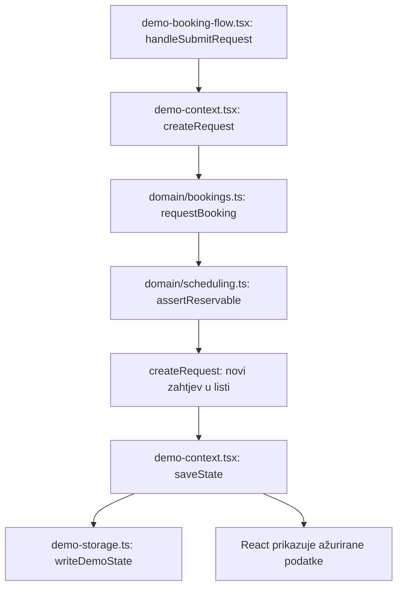

# Kako čitati i održavati Terapeut.me

Ovaj vodič je za osobu koja zna osnove JavaScripta, ali tek upoznaje Next.js, NestJS i TypeScript. Za poslovni dogovor prvo pročitajte [decisions.md](decisions.md). Ovaj fajl objašnjava gdje se taj dogovor nalazi u kodu.

## Tri dijela projekta

| Folder            | Šta radi                                            | Gdje početi                                                              |
| ----------------- | --------------------------------------------------- | ------------------------------------------------------------------------ |
| `apps/web`        | Stranice koje korisnik vidi, formulari, kalendari   | `src/app/layout.tsx`                                                     |
| `packages/domain` | Pravila zakazivanja, bez HTML-a i pristupa browseru | `src/scheduling.ts`, zatim `src/bookings.ts`                             |
| `apps/api`        | Stvarna registracija, prijava, SMTP i sesije u bazi | `src/main.ts`, `src/auth/auth.controller.ts`, `src/auth/auth.service.ts` |

`workspaces` u glavnom `package.json` povezuje ova tri dijela. Jedno `npm.cmd install` instalira njihove zavisnosti. Import `@terapeut/domain` znači zajednički paket iz ovog projekta, a ne biblioteku preuzetu sa interneta.

**Katalog, profili, radno vrijeme i stvarne rezervacije koriste PostgreSQL i API.** Terapeut unosi trajanje seanse od 5 do 240 minuta. Terapeut uređuje raspored na `/dashboard`; pacijent bira termin na `/therapist/[id]/book` i vidi svoje zahtjeve na `/account`. Za tačan tok čuvanja i mjesta za breakpoint pročitajte [scheduling.md](scheduling.md). JWT prijava je u [auth.md](auth.md), a fotografije u [directory.md](directory.md). Odvojeni demo na `/demo/...` ostaje lokalni.

## Kako Next.js pronađe stranicu

Privatna analitika terapeuta je na `/dashboard/analytics`: `features/profile-analytics.tsx` odvojeno prikazuje trenutno stanje svih rezervacija i istorijske radnje u periodu, `features/analytics-visitors.tsx` različite/ponovljene posjete i tabele, a API `analytics/analytics.service.ts` računa podatke iz baze. „Primljeni zahtjevi u periodu“ uključuju i već obrađene; „Na čekanju sada“ pokazuje samo aktivno čekanje. Migracija 014 dodaje svaki pregled, uključujući anonimne browsere i ponavljanja. Definicije i debugging su u [profile-analytics.md](profile-analytics.md).

Next.js koristi nazive foldera unutar `apps/web/src/app`. Fajl `page.tsx` predstavlja jednu stranicu. Fajl `layout.tsx` je omotač oko stranica: dodaje zajednički HTML i komponente.

| Adresa u browseru                            | Ulazni fajl u `src/app`             | Glavni prikaz                                 |
| -------------------------------------------- | ----------------------------------- | --------------------------------------------- |
| `/`                                          | `page.tsx`                          | Početna stranica u istom fajlu                |
| `/psychotherapy`                             | `psychotherapy/page.tsx`            | `features/directory.tsx`                      |
| `/therapist/ana-markovic`                    | `therapist/[id]/page.tsx`           | `features/profile.tsx`                        |
| `/therapist/ana-markovic/book`               | `therapist/[id]/book/page.tsx`      | `features/booking-flow.tsx`                   |
| `/dashboard`                                 | `dashboard/page.tsx`                | `features/dashboard.tsx`                      |
| `/demo/dashboard`                            | `demo/dashboard/page.tsx`           | `features/demo-dashboard.tsx`                 |
| `/demo/therapist/ana-markovic/book`          | `demo/therapist/[id]/book/page.tsx` | `features/demo-booking-flow.tsx`              |
| `/login`, `/register`, `/register/therapist` | Odgovarajući folder i `page.tsx`    | `features/auth-pages.tsx` i terapeutska polja |
| `/account`                                   | `account/page.tsx`                  | `features/account.tsx`                        |
| `/faq`, `/privacy`, `/terms`                 | Odgovarajući folder i `page.tsx`    | Sadržaj u samom fajlu                         |

`[id]` znači promjenljivi dio adrese. Next.js iz njega daje `params`, a `ProfilePage` ili `BookingPage` čita ID i prosljeđuje ga prikazu. `await params` je dio načina na koji ova verzija Next.js daje parametre stranice; ovdje ne predstavlja poziv bazi.

`metadata` podešava naslov browser taba i opis stranice. `loading.tsx` prikazuje učitavanje, `error.tsx` grešku sa ponovnim pokušajem, a `not-found.tsx` nepostojeću adresu.

## Kako čitati React prikaz

Indikatori čekanja koriste `Spinner`, `ActionButton` i `PendingStatus` iz `components/ui.tsx`. Vodič [loading-feedback.md](loading-feedback.md) objašnjava početak/kraj zahtjeva, blokiranje ponovljenog klika i mjesta za breakpoint pri debugovanju.

`ProfileLoading` prikazuje učitavanje profila, a `SaveFeedback` jasnu poruku čekanja, potvrde ili greške. Potvrda uspjeha automatski nestaje poslije četiri sekunde; njen timer se uklanja pri promjeni poruke ili zatvaranju komponente. Raspored vraća lokalni rezultat `{ saved, message }` svakom formularu. `handleChange` uklanja staru potvrdu čim počne novi unos. Uspjeh se ne prikazuje prije potvrđenog API odgovora. Greška i čekanje nemaju automatsko skrivanje.

`ScheduleEditor.getSavedMessage` razlikuje uslugu i dostupnost. Zajednički prikaz daje jednu potvrdu: „Seansa je sačuvana.“ ili „Raspored je sačuvan.“. Lokalni editori koriste rezultat za zatvaranje/reset formulara i prikaz greške, bez druge potvrde uspjeha.

Funkcija koja vraća HTML-sličan zapis, npr. `BookingFlow`, jeste komponenta. Taj zapis se zove JSX. U njemu `className` označava CSS klasu, a `{...}` prikazuje vrijednost iz JavaScripta. Osnovni CSS je u `app/globals.css`; `app/brand.css` dodaje izgled po uzoru na terapeut.me. Lokalni fontovi, logo, fotografija i mjesta za vizuelni debugging opisani su u [appearance.md](appearance.md). Stilovi imaju komentare po cjelinama.

Komponenta dobija ulazne podatke kao argumente, često nazvane _props_. Na primjer, `<CalendarPicker duration={60} ... />` govori kalendaru koliko traje seansa. Povratna funkcija poput `onDate` govori roditeljskom prikazu koji je datum korisnik izabrao.

`"use client"` na početku fajla znači da komponenta koristi browser, događaje ili React stanje. Poslovna pravila u `packages/domain` to ne koriste i ne treba im taj red.

Najčešći oblici u ovom projektu:

```tsx
// useState pamti izbor. Poziv setSelectedStart ponovo prikazuje ekran.
const [selectedStart, setSelectedStart] = useState<number | null>(null);

// onClick samo povezuje dugme sa jasno imenovanom funkcijom.
<button onClick={submitProposal}>Pošalji predlog</button>;

// Poslovna pravila su u funkciji, a ne sakrivena unutar velikog HTML-a.
function submitProposal() {
  // Provjera i slanje predloga nalaze se u features/booking-card.tsx.
}
```

`useEffect` pokreće rad poslije prikaza u browseru. Koristimo ga za učitavanje podataka i timer. Ako postavlja timer ili sluša događaje, mora vratiti funkciju koja ih uklanja. U `demo-context.tsx` to je `stopListening`.

`useRef` čuva najnovije podatke za timer bez čekanja novog prikaza. `useCallback` tamo zadržava istu funkciju za čuvanje, da se učitavanje i timer ne pokreću ponovo poslije svake izmjene. Ovi alati nijesu potrebni za svaku funkciju ili formular.

TypeScript dodaje opis podataka JavaScriptu. `Booking` je oblik zahtjeva iz `types.ts`, `Booking | null` znači „zahtjev ili još nema vrijednosti“, a `Partial<Therapist>` znači da šaljemo samo izmijenjena polja profila. Tipovi pomažu editoru i provjeri, ali ne zamjenjuju provjeru korisnikovog unosa.

Kod koristi nekoliko običnih operacija nad listom:

| Zapis             | Značenje                                                            |
| ----------------- | ------------------------------------------------------------------- |
| `.find(...)`      | Pronađi jedan element, npr. zahtjev po ID-u                         |
| `.filter(...)`    | Napravi listu samo elemenata koji odgovaraju uslovu                 |
| `.map(...)`       | Napravi novu listu sa obrađenim elementima                          |
| `.some(...)`      | Provjeri da li postoji bar jedan element koji odgovara              |
| `...booking`      | Kopiraj postojeća polja; polja navedena poslije mogu da ih zamijene |
| `state?.bookings` | Čitaj listu samo ako state već postoji                              |

Za računanje slobodnih intervala koristimo obične `for` petlje, da svaki korak bude vidljiv.

## Gdje su podaci i akcije

`app/layout.tsx` omotava stranice komponentama `DemoProvider`, `AuthProvider` i `DirectoryProvider`. `useDemo()` daje lokalne rezervacije i jezik, `useAuth()` vlastiti nalog, a `useDirectory()` javne profile iz baze. Demo uloga ne utiče na serversku sesiju niti na javni katalog.

| Fajl                           | Odgovornost                                              |
| ------------------------------ | -------------------------------------------------------- |
| `lib/demo-context.tsx`         | Učitava stanje i povezuje akcije sa pravilima i čuvanjem |
| `lib/demo-storage.ts`          | Čita i piše JSON u `localStorage` browsera               |
| `lib/errors.ts`                | Pretvara oznake grešaka u poruke korisniku               |
| `lib/format.ts`                | Formatira datum i pretvara sate u minute                 |
| `lib/excel-export.ts`          | Pravi i preuzima Excel, bez slanja emaila                |
| `packages/domain/src/types.ts` | Opisuje polja profila, usluge, zahtjeva i istorije       |
| `packages/domain/src/seed.ts`  | Izmišljeni početni profili i demo zahtjevi               |

`translate("Tekst", "English text")` bira jedan od dva već napisana teksta. Ne prevodi automatski. Nazivi `nameEn`, `bioEn` i slični sadrže englesku verziju podatka.

`localStorage` čuva tekst samo u određenom browseru. `JSON.stringify` pretvara podatke u tekst, a `JSON.parse` ih vraća u objekat. Verzija skladišta je 1. Nemojte mijenjati oblik sačuvanih podataka bez plana za stare podatke ili reset demo verzije.

## Kako nastaju ponuđeni termini

Lista čekanja čuva konkretan termin ili prihvatljive dane i sate. `WaitlistService.allocate` pod istim lock-om terapeuta dodjeljuje jednu potvrđenu seansu prvom odgovarajućem klijentu; upis, istorija i email red su atomski. Formular, povlačenje, redosljed i mjesta za breakpoint opisani su u [waitlist.md](waitlist.md).

Stalni termini imaju trajno pravilo na 7/14 dana i zasebne rezervacije u narednih 90 dana. `RecurringBookingService` dopunjava dospjele datume poslije restarta, u pozadini i prije prikaza/upisa termina. `occurrence_date` ostaje prvobitni datum i kad se samo jedna seansa pomjeri. Checkbox, prekid serije i zamjena neradnog datuma opisani su korak po korak u [recurring-bookings.md](recurring-bookings.md).

Kalendar nije spisak unaprijed sačuvanih pojedinačnih termina. Računa moguće početke iz dostupnosti i već zauzetog vremena.

1. Stvarni `BookingFlow.handleChooseService` bira aktivnu seansu terapeuta, a `ServerCalendar` čita živu zauzetost iz API-ja. `BookingService.slots` poziva zajednička pravila. Naredna tri koraka opisuju i računanje na serveru i odvojeni demo kalendar.
2. `CalendarPicker.getStartsForDate` poziva `availableStarts`.
3. `freeRanges` uzima sate dostupnosti za taj dan i oduzima zahtjeve i blokade.
4. `availableStarts` prolazi kroz slobodne intervale na 15 minuta i zadržava početke gdje cijela seansa staje.

Vrijeme u podacima je broj minuta od ponoći: **16:00 = 960**, **16:15 = 975**. `timeLabel` služi samo za prikaz. Datum je tekst `YYYY-MM-DD`. Zona projekta je `Europe/Podgorica`.

Primjer: dostupno 16–20, zauzeto 16–16:15, usluga 60 minuta. Prvi mogući termin je 16:15–17:15. Zahtjevi na čekanju takođe zauzimaju interval. Sve usluge jedne osobe koriste istu zauzetost.

## Šta se desi na „Pošalji zahtjev“ u odvojenom demou



Formular čita ime, email i telefon. `requestBooking` provjerava kontakt, uslugu i termin. Cijenu i trajanje uzima iz usluge, a ne iz proizvoljnog formulara. Kopija tih vrijednosti ostaje u zahtjevu čak i ako terapeut kasnije izmijeni uslugu.

Ako provjera ne uspije, `DomainError` nosi oznaku poput `SLOT_UNAVAILABLE`. `errorText` daje poruku na ekranu. Ne zaobilaziti provjeru samo zato što je dugme ranije prikazalo slobodan termin.

## Promjena A → B

U `booking-card.tsx` funkcija `submitProposal` poziva demo akciju `propose`. Ona vodi u `proposeNewTime`, pa u `domain/bookings.ts: proposeAlternative`.

**B se prvo provjerava.** Ako nije dostupan, zahtjev ostaje na A. Ako jeste, jedna nova verzija zahtjeva dobija B i status `ALTERNATIVE_PROPOSED`. U istom čuvanju A prestaje da blokira kalendar, a B počinje da ga blokira. Prethodni datum i početak upisuju se u istoriju.

Ne praviti dvije odvojene radnje „oslobodi A“ i „zauzmi B“. Stvarni `BookingService.respond` čuva promjenu termina, događaj istorije i outbox obavještenje u jednoj transakciji. SMTP se poziva tek nakon `COMMIT` kroz `BookingNotificationService`. Vodič [booking-notifications.md](booking-notifications.md) objašnjava primaoce, retry, polja reda i mjesta za breakpoint.

## Kako je podijeljen dashboard

### Klijentov nalog i uređivanje profila

Privatne materijale i domaće zadatke prikazuje `features/materials.tsx` u klijentovom nalogu i na terapeutovom pregledu. `MaterialsService` provjerava vezu sa klijentom, vlasništvo i verziju; PDF se čuva u bazi i preuzima zasebnim zaštićenim pozivom. Dodjela, uređivanje, povlačenje i mjesta za breakpoint su u [client-materials.md](client-materials.md).

`features/account.tsx` na `/account` prvo prikazuje klijentove termine, pa profil. Prečice vode do termina, podataka i kataloga. Meni „Moj nalog“ ima i klijentsku prečicu „Moji termini“; profil otvara na `#my-profile`. `ServerBookings` čita istu privatnu listu iz baze i prikazuje filtere za sve termine, čekanje, potvrđene termine i istoriju. Budući aktivni termini idu po datumu i satu od najbližeg, bez prednosti statusa. Prošle seanse bez upisanog ishoda slijede iza budućih, pa istorija od najnovije. Najbliži budući potvrđeni termin prikazuje se iznad filtera. Link „Detalji termina“ vraća filter na sve termine da odabrana kartica bude dostupna.

`features/client-booking-summary.tsx` odvaja klijentov prikaz kartice od zajedničkih serverskih akcija u `ServerBookingCard`. Ime terapeuta, naziv, datum, vrijeme, trajanje i cijena dolaze iz privatne rezervacije. Javni katalog dodaje fotografiju, zvanje i sadašnju adresu ordinacije. Ako katalog nije dostupan ili profil više nije javan, rezervacija i njena istorija ostaju vidljivi, sa zamjenskom ikonom. Prihvatanje, odbijanje i otkazivanje i dalje pozivaju postojeći API sa provjerom vlasništva. `getHistoryLabel` prevodi sačuvani događaj u razumljiv naslov. `getHistoryTimeLabel` bira naziv datuma prema radnji: „Prethodni termin“ za predlog A → B, „Prihvaćeni termin“ za prihvatanje B. Polje `previousDate` je datum prije konkretne radnje: kod prihvatanja to je već B. Originalni zapisi se ne mijenjaju.

`features/account-profile-summary.tsx` prikazuje posljednje potvrđene lične i kontakt podatke. `AccountProfileEditor` prikazuje ili ovaj pregled ili formular, pa se stari podaci ne dupliraju pored nezavršenog unosa. Formular razdvaja lične i kontakt podatke; terapeut ima i profesionalnu grupu. Sve grupe šalju se zajedno kroz postojeći `POST /auth/profile`. Tek uspješan odgovor mijenja `AuthProvider` i vraća novi pregled. „Odustani“ zatvara formular bez HTTP upisa; ponovno otvaranje uzima sačuvane vrijednosti. Greška zadržava unos, a potvrda uspjeha nestaje nakon četiri sekunde.

### Terapeutov pregled

Terapeut odmah poslije prijave vidi zahtjeve, a tek zatim podešavanja. `ServerBookings` koristi isti hronološki redosljed kao klijentov pregled i nudi filtere sa brojevima: svi, na čekanju, potvrđeni i istorija. Filtriranje mijenja samo prikaz; API i dalje čita privatne podatke kroz JWT i provjerava svaku radnju.

`ScheduleEditor` grupiše usluge, sedmične sate i posebne datume u tri zatvorene `<details>` sekcije. Klik ili Enter na naslov otvara sekciju. Zatvaranje ne uklanja formular i ne briše unos. `components/time-field.tsx` prikazuje odvojene liste sata (00–23) i minuta (00–59). `readTimeField` čita te dvije vrijednosti iz `FormData`, a postojeći `timeToMinutes` ih pretvara u API minute. Nema novog ograničenja na korake od 15 minuta; kraj 00:00 i dalje znači 1440, kraj dana.

`components/account-menu.tsx` je padajući „Moj nalog“ u zajedničkoj navigaciji. Tu su profil, terapeutski pregled i odjava, uključujući telefon. Klik van liste ili Escape zatvara prikaz; Escape vraća fokus. `handleLogout` prvo čeka opoziv sesije na serveru, pa poziva `setUser(null)` i otvara prijavu. Greška ostavlja nalog i mogućnost ponovnog pokušaja. Efekat uklanja document slušače kad se meni zatvori; promjena stranice zatvara listu.

`features/dashboard.tsx` prikazuje stvarni radni prostor sa `schedule-editor.tsx` i `server-bookings.tsx`. `booking-flow.tsx` i `server-calendar.tsx` koriste API i ne čitaju lokalne rezervacije. `booking-client.ts` sadrži HTTP pozive. Na API-ju `booking.service.ts` vodi dozvole, računanje i transakcije, a `booking.repository.ts` čitanje/istoriju/isticanje. `features/demo-dashboard.tsx` na `/demo/dashboard` bira samo probnu ulogu i ekran. Konkretni demo sadržaj je odvojen:

| Fajl                     | Šta se tu mijenja                                  |
| ------------------------ | -------------------------------------------------- |
| `requests-list.tsx`      | Grupisanje po statusu i broj zahtjeva              |
| `booking-card.tsx`       | Detalji i dugmad za pojedinačni zahtjev            |
| `week-calendar.tsx`      | Nedjeljni raspored i položaj blokova po satima     |
| `therapist-settings.tsx` | Dodavanje usluga, dostupnosti i uređivanje profila |
| `service-editor.tsx`     | Formular uređivanja jedne usluge                   |
| `admin-dashboard.tsx`    | Verifikacija, javna aktivnost i dugme za izvoz     |

`?mode=admin` ili `?mode=therapist` na `/demo/dashboard` služi za demo. **To nije autentifikacija.** Parametri na `/dashboard` ne mijenjaju stvarnu ulogu. API provjerava ulogu i vlasništvo na serveru; skriveno dugme nije zaštita.

`auth.jwt.ts` potpisuje i provjerava JWT, a `auth.service.ts` dodatno provjerava aktivnu sesiju i ulogu u bazi. Token ostaje u HttpOnly kolačiću. `auth-client.ts: accountHome` bira katalog za pacijenta i dashboard za terapeuta poslije prijave i registracije. `account-profile-editor.tsx` na `/account` šalje sva polja profila jednim zahtjevom; `therapist-profile-editor.tsx` mu dodaje zvanje i biografiju kao obična polja. Server čuva profil i kontakt u jednoj transakciji i zadržava usluge, verifikaciju i istoriju. `AuthProvider` prekida staro učitavanje pri prijavi/odjavi da stari odgovor ne zamijeni novi identitet. Detalji su u [auth.md](auth.md).

`session-editor.tsx` ima zaseban formular za svaku seansu i za dodavanje nove. Ista API radnja `service` koristi `serviceId` samo pri izmjeni postojeće seanse. Naziv, trajanje (5–240 min) i cijena čuvaju se samo kod vlasnika. `remove-service` označava seansu neaktivnom. Ranije rezervacije zadržavaju kopije naziva, cijene i trajanja. `migrate.ts` preskače već evidentirane migracije da stara ograničenja iz 005 ne isključe nova trajanja.

`availability-editor.tsx` daje formular izmjene postojećeg sedmičnog perioda i uređivanje pojedinačnih datuma. Jedan aktivan datum u `availability_dates` zamjenjuje sedmične sate samo za taj dan; neradni datum nema ponuđenih početaka. Brisanje/pomjeranje posebnog datuma vraća stari dan na sedmični raspored. `freeRanges` bira odgovarajući raspored prije oduzimanja rezervacija, pa su provjere iste u klijentskom prikazu i API upisu. Detalji su u [scheduling.md](scheduling.md).

Vraćanje sedmičnog rasporeda sada ima korak objašnjenja i potvrde u `DateAvailabilityEditor`; odustajanje zadržava neradni datum. `BookingService.slots` daje `dayOff` iz aktivnog datuma u istom snimku baze kao termini, a `ServerCalendar` prikazuje jasnu poruku da terapeut tog dana ne radi. Neaktivan zapis nije važeći neradni dan i ne smije se miješati sa `is_working=false`.

## Kako čitati NestJS dio

`features/password-reset-pages.tsx` vodi `/forgot-password` i `/reset-password`: korisnik prima email link, unosi i potvrđuje novu lozinku, pa automatski otvara početni ekran svoje uloge. `password-reset.jwt.ts` potpisuje poseban JWT sa rokom od 15 minuta. `password-reset.service.ts` čuva samo njegov hash i u jednoj transakciji mijenja lozinku, troši link, opoziva stare sesije i izdaje novu. `AuthService.createSession` je zajednička serverska metoda za prijavu, registraciju i obnovu; ne prihvata HTTP pozive direktno. Vodič sa mjestima za breakpoint je u [auth.md](auth.md).

`features/account-profile-editor.tsx` ima imenovane korake otvaranja, odustajanja i čuvanja cijelog profila. Obje uloge u jednom formularu mijenjaju ime, prezime, datum rođenja, telefon, grad i adresu; terapeut tu ima i zvanje i biografiju. `POST /auth/profile` određuje vlasnika iz JWT-a i čuva podatke u jednoj transakciji. Klijentov privatni grad/adresa su u `users`, a javni podaci ordinacije u `therapists`. `setUser` i ponovno učitavanje pregleda terapeuta mijenjaju prikaz tek nakon potvrde upisa u bazu. Detaljni koraci i mjesta za breakpoint su u odjeljku „Uređivanje vlastitog profila“ u [auth.md](auth.md).

`main.ts` je ulaz u API. `bootstrap` kreira aplikaciju iz `AppModule`, dodaje početak adrese `/api/v1` i podešava dozvoljeni frontend. `config.ts: apiListenAddress` koristi Render `PORT` prije lokalnog `API_PORT`; lokalno sluša na `127.0.0.1:4000`, a u produkciji na `0.0.0.0`.

`app.module.ts` uključuje health/auth/directory/booking controllere, PostgreSQL servis, poslovne servise i provjeru Origin-a. `health.controller.ts` povezuje adresu sa funkcijom:

```text
main.ts: /api/v1 + @Controller("health") + @Get() = GET /api/v1/health
```

Zapisi koji počinju sa `@` nazivaju se dekoratori. Oni NestJS-u govore na kojoj adresi treba pozvati metodu. `health()` provjerava bazu i osam dodatnih migracija, pa vraća JSON sa `bookingApi: enabled` i `bookingNotifications: outbox`. `@Inject` eksplicitno povezuje servise i radi i pri razvojnom pokretanju kroz `tsx`.

`config.ts` učitava root `.env` prije pokretanja API-ja i provjerava obavezne vrijednosti. `.env.example` sadrži samo primjere; tajni ključ treba generisati, a SMTP lozinku unijeti lokalno. Tajne nijesu frontend podaci. `main.ts` ograničava JSON tijelo i podešava dozvoljene adrese iz `WEB_ORIGINS`.

## Baza i konfiguracija

`compose.yaml` pokreće lokalni PostgreSQL na portu 5432. `db/schema.sql` pravi početne tabele kada Docker kreira **novu** bazu ili kada `npm.cmd run db:migrate` pronađe praznu šemu. Postojeće tabele i podaci se ne resetuju; izmjena SQL fajla ne mijenja već postojeću bazu, za to treba nova migracija.

Free hosting je opisan korak po korak u [deployment.md](deployment.md). `render.yaml` priprema besplatni NestJS servis sa ručno unesenom Neon `DATABASE_URL`; `start:render` prvo pokreće migracije, pa API, bez demo uvoza. Jedna migraciona konekcija drži session lock da dva starta ne izvrše isti korak zajedno. Neon Free ima ograničenja prostora i potrošnje, a uspavan Render API odlaže pozadinske poslove. Neon veza mora biti direktna zbog session lock-ova; koraci su u [neon.md](neon.md). `apps/web/vercel.json` gradi frontend i zajednički paket iz monorepo korijena. `next.config.ts` provjerava `API_ORIGIN` i prosljeđuje `/api/v1` pozive Renderu. Kolačić ostaje na frontend adresi; tajne baze i emaila postoje samo na API-ju.

`EmailService` koristi `AUTH_EMAIL_MODE`: `local` za Mailpit, `smtp` za SMTP dostavu, `resend` za Resend HTTPS API ili izričito `disabled`. Posljednji režim omogućava pokretanje bez email tajni, ali blokira registraciju/reset i ostavlja booking outbox netaknut. Kasnije `RESEND_API_KEY` i `RESEND_FROM` uključuju istu dostavu za sve vrste poruka. Poziv provajderu ima rok od 15 sekundi; u logove ne ulaze sadržaj, ključ ni odgovor provajdera. Tok je u [auth.md](auth.md).

`db/migrations/002-auth.sql` dodaje polja korisnika, privremene registracije, sesije i trajne brojače pokušaja. `npm.cmd run db:migrate` primjenjuje ovu migraciju na postojeću bazu bez reseta. Mailpit koristi portove 1025 za SMTP i 8025 za testno sanduče. Ne dostavlja poruke na stvarne email adrese.

`003-therapist-registration.sql` dodaje vrstu registracije i privremene profesionalne podatke. Ista komanda primjenjuje obje migracije. Nakon potvrde koda `auth.service.ts` u jednoj transakciji čuva korisnika, povezani profil u `therapists` i uslugu u `services`. Odbijena transakcija ne ostavlja djelimičan nalog. `therapist-registration-fields.tsx` prikazuje dodatna polja, a `therapist-account-profile.tsx` učitava samo vlastiti profil kroz serversku provjeru uloge i vlasništva.

`004-directory-photos.sql` dodaje nedostajuće javne podatke i fotografije u bazi. `npm.cmd run db:migrate` primjenjuje sve tri dodatne migracije; `npm.cmd run db:seed` jednom uvozi stare probne profile i njihove usluge/dostupnosti. Javni prikazi više ne čitaju profile iz `localStorage` ili direktno iz `seed.ts`. Seed se koristi samo za uvoz i odvojeni demo. Fotografije se mijenjaju isključivo kroz provjeru vlasnika na API-ju.

`005-booking-sessions.sql` dodaje nedostajuća standardna trajanja i zadržava stare usluge/istoriju. `EXCLUDE` pravilo u `booking_requests` sprečava preklapanje aktivnih zahtjeva istog terapeuta, uz novu provjeru i zaključavanje na API-ju. `db/checks.sql` provjerava SQL pravila i na kraju radi `ROLLBACK`, pa ne ostavlja testne podatke.

`006-profile-contact.sql` dodaje opcioni privatni grad i adresu u `users`. Primjenjuje se sa `npm.cmd run db:migrate`; postojeći podaci ostaju sačuvani. Terapeutova ordinacija i dalje koristi `therapists.city/address`.

`007-password-reset.sql` dodaje hash, vlasnika i rok linkova za obnovu lozinke. Nalog ili rezervacija se ne brišu. Izdavanje i korišćenje linka prvo zaključavaju red u `users`, pa reset zapise; isti redosljed sprečava međusobno blokiranje tih radnji.

`008-date-availability.sql` dodaje raspored za pojedinačne datume i zabranu duplog aktivnog datuma istog terapeuta. Izmjena koristi isti ID, uklanjanje ostavlja neaktivan red, a rezervacije i istorija ostaju sačuvane.

`009-booking-notifications.sql` dopunjava `notification_outbox` očekivanom verzijom zahtjeva i razlogom preskakanja poruke. Stari zahtjevi ne dobijaju nove poruke. `BookingNotificationService` obrađuje nove događaje poslije transakcije, ponavlja SMTP greške i provjerava vlasnika i verziju prije slanja.

`package.json` je običan JSON i ne podržava komentare. Njegove npm komande su opisane u README-u. `tsconfig.json` podešava TypeScript provjere; `next.config.ts` podešava Next.js; `playwright.config.ts` pokreće browser testove na odvojenom portu 3100. `next-env.d.ts` generiše Next.js i ne treba ručno uređivati.

## Gdje tražiti konkretnu izmjenu

| Željena izmjena                 | Početni fajl                                                                         |
| ------------------------------- | ------------------------------------------------------------------------------------ |
| Tekst na početnoj               | `apps/web/src/app/page.tsx`                                                          |
| Boje, razmaci, mobilni prikaz   | `apps/web/src/app/globals.css`                                                       |
| Novi filter                     | `features/directory.tsx`, posebno `matchesFilters`                                   |
| Razmak ponuđenih početaka       | `packages/domain/src/scheduling.ts`, `START_INTERVAL`                                |
| Novi poslovni status ili akcija | `domain/types.ts`, `domain/bookings.ts`, `components/ui.tsx`, zatim SQL migracija    |
| Drugačiji Excel sadržaj         | `lib/excel-export.ts`                                                                |
| Kontakt formular                | `features/booking-flow.tsx`; provjere su u `domain/bookings.ts`                      |
| Povezivanje sa serverom         | Novi API servisi i zamjena demo akcija; ne unositi HTTP pozive u računanje intervala |

## Pravila za jednostavan kod

Koristite puna imena poput `booking`, `therapist` i `selectedService`. Jedna funkcija treba da ima jasno opisanu odgovornost. Duže akcije stavite u imenovanu funkciju iznad JSX prikaza. Za više mogućnosti koristite običan `if`, a za računanje intervala obične petlje. Dodajte komentar koji objašnjava rezultat i važno poslovno pravilo.

Ne treba praviti novu apstrakciju ili dodavati biblioteku samo da bi se uštedjelo nekoliko redova. Tipove, provjere preklapanja, istoriju i buduće serverske dozvole treba zadržati: čitljivost ne znači uklanjanje zaštite podataka.

Poslije izmjene pokrenite provjere iz [README-a](../README.md). Domenski testovi provjeravaju pravila, a browser testovi prolaze kroz stvarne formulare. `npm.cmd run format` uređuje format; ne provjerava ispravnost poslovnog pravila.

`.prettierrc.json` zadržava postojeći Windows/Unix kraj reda (`endOfLine: auto`), pa provjera formata ne zahtijeva izmjenu svih starih fajlova samo zbog CRLF/LF razlike.
